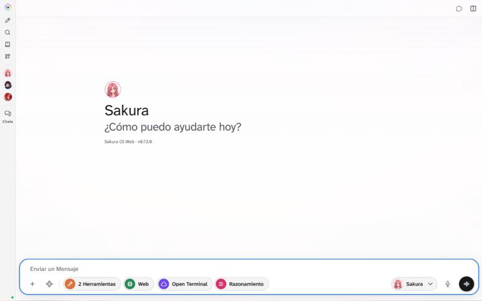
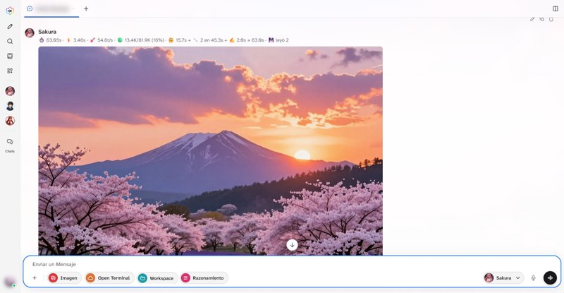
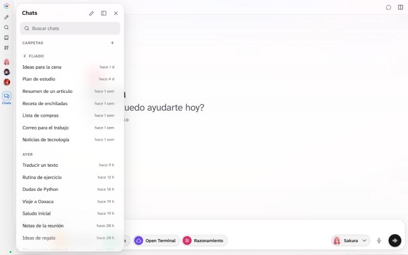
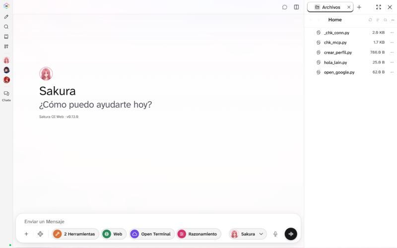
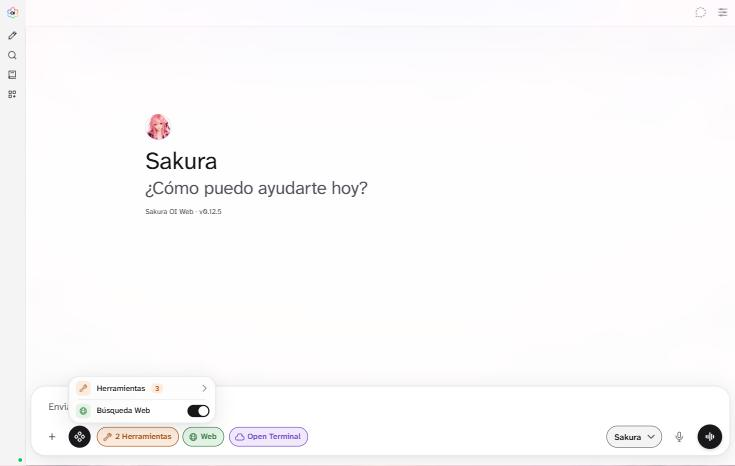
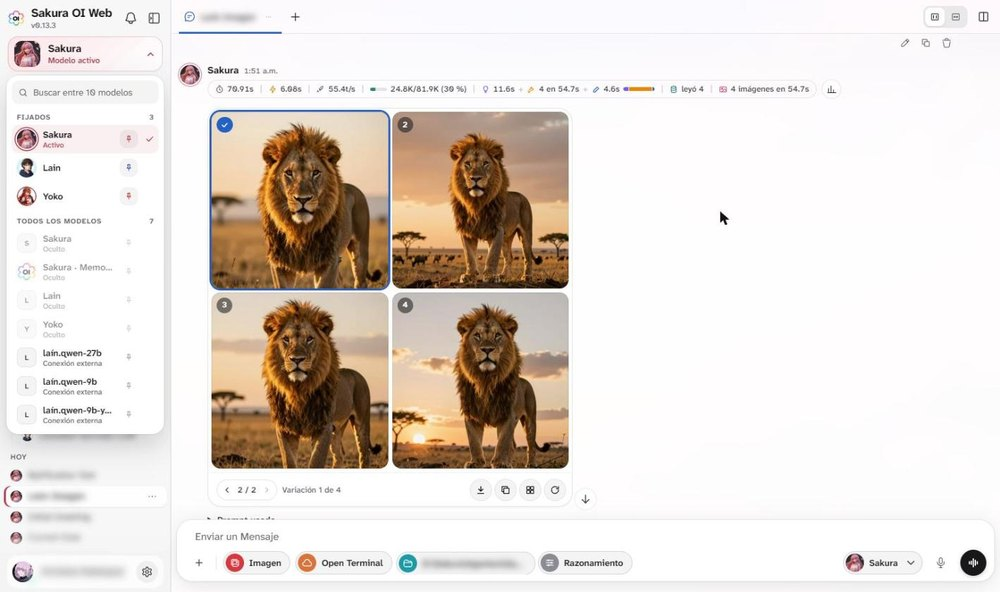
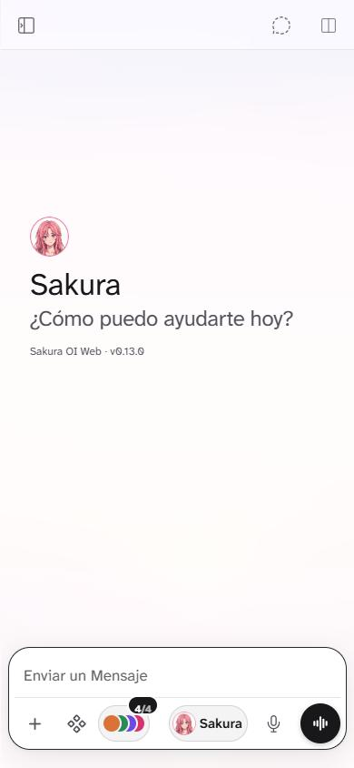
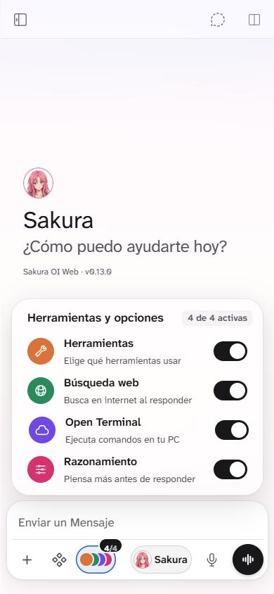

# Carbono para Open WebUI

**Versión 0.85** · probado con Open WebUI **0.13.0**

Carbono es el tema recomendado para [Sakura OI Web](https://github.com/YukiChristian/Sakura-OI-Web). Deja la interfaz de Open WebUI neutra (superficies en tonos carbón y zinc, acción principal en negro), con más jerarquía en el texto, tipografía Atkinson Hyperlegible, menús de vidrio esmerilado y un composer pensado para el teléfono.

No modifica Open WebUI: son dos archivos (`carbono.css` y `carbono.js`) que tu lanzador sirve en lugar de los vacíos que Open WebUI ya carga en cada página (`/static/custom.css` y `/static/loader.js`). Se activa y se quita con un comando y sobrevive a `pip install -U open-webui`.

La guía de estilo (principios, colores, tipografía y componentes) está en [docs/GUIA.md](docs/GUIA.md).

## Capturas

### Escritorio

| Inicio | Conversación |
| --- | --- |
|  |  |

| Barra contraída con chats | Panel lateral de pestañas |
| --- | --- |
|  |  |

| Integraciones | Selector de modelo |
| --- | --- |
|  |  |

### Móvil

| Composer | Herramientas y opciones |
| --- | --- |
|  |  |

## Qué cambia

- **Tipografía:** Atkinson Hyperlegible Next para la interfaz y Atkinson Hyperlegible Mono para código (Google Fonts).
- **Barra lateral:** filas del mismo tamaño, chat activo con fondo gris y barra de 3 px, etiquetas de sección en mayúsculas.
- **Chat:** globo de tus mensajes en gris neutro, fondo de cada modelo con un velo blanco degradado y desenfocado para que el texto se lea primero, y barra de título de vidrio esmerilado.
- **Composer en escritorio:** chips neutros con una insignia redonda de color (Herramientas naranja, Web verde, Open Terminal violeta, Razonamiento rosa), una línea que los separa de `+` e Integraciones y, a la derecha, el modelo con su avatar, el micrófono y la voz. Si la caja es angosta, los chips se quedan solo con su insignia.
- **Composer en el teléfono:** texto arriba; abajo `+`, Integraciones, un botón de opciones con las insignias de color de las opciones activas encimadas y un contador «4/4», el modelo con su avatar, el micrófono y la voz. El botón abre la hoja de vidrio **Herramientas y opciones**, donde cada opción tiene su ícono, su descripción y su interruptor encendido o apagado.
- **Menús:** vidrio esmerilado (blanco al 60 % con desenfoque) en todos los menús flotantes y en el selector de modelo; nunca se salen de la ventana y muestran todas sus opciones.
- **Administración y Zona de Pruebas:** pestañas en control segmentado, tabla de usuarios en tarjeta con el rol en píldora, buscador y botones de 46 px, instrucciones del sistema en tarjeta, un recuadro punteado que explica qué hacer cuando no hay mensajes y botón **Ejecutar** en negro.
- **Ajustes, Notas, Espacio de Trabajo, Calendario y Automatizaciones:** jerarquía título › sección › ajuste › descripción y botón **Crear** en negro.
- **Notificaciones, inicio de sesión y modo voz:** colores de estado del sistema, campos de 44 px y botones de voz de 64 px con su etiqueta.
- **Rendimiento:** los selectores evitan buscar por el atributo `class` dentro de `:has()`, que obliga al navegador a recalcular toda la página en cada hover.

## Cambios

### 0.85

- Composer rediseñado («Composer elegido»): chips neutros con insignia redonda de color e ícono blanco, línea divisoria y el avatar del modelo en su chip; en el teléfono, el botón de opciones muestra las insignias encimadas y un contador «4/4», y la hoja usa las mismas insignias.
- Barra lateral contraída: botón **Chats** que abre un panel de vidrio con carpetas (y crear carpeta), fijados e historial por fecha con buscador, y avatares de los modelos fijados para empezar un chat nuevo.
- Panel lateral de pestañas de 0.13.0 (Archivos, Terminal, Navegador, Desktop): pestañas compactas con la activa marcada, íconos gris oscuro del mismo tamaño, barra de la misma altura que la de título, línea fina de separación con el chat y menú «+» de vidrio.
- Ventana **Herramientas Disponibles** de vidrio, como los menús.
- Íconos de la barra de título más oscuros y parejos.
- El chip Razonamiento sigue apareciendo solo en modelos con nivel de razonamiento.

### 0.84

Ajustes para Open WebUI 0.13.0:

- El chip **Razonamiento** solo aparece con los modelos que tienen nivel de razonamiento (`model_controls`). En 0.13.0 ese botón es «Controles del modelo» y se muestra a los administradores con cualquier modelo; con los demás modelos se queda junto al modelo como ícono normal (en el teléfono se oculta para que quepa el nombre del modelo).
- Corregido: la hoja **Herramientas y opciones** volvía a desenfocar solo la caja de escribir y no el chat de atrás (0.13.0 le pone su propio desenfoque a la caja).
- Corregido: el botón **Enviar** al editar un mensaje se veía negro sin texto (el editor ahora vive dentro del globo del mensaje).
- Corregido: en Administración › Modelos la primera fila salía más chica y la lista no se podía desplazar (comparte `#model-list` con el Espacio de Trabajo); ahora se desplaza y la barra se ve siempre.
- Espacio de Trabajo: pestañas en control segmentado, como Administración, y el botón **Crear** ya no se sale por la derecha en ventanas angostas.
- Composer en escritorio: los chips se comprimen a solo ícono cuando no caben.
- Teléfono: el contador del botón de opciones es un óvalo con el total y las activas; la hoja muestra cada opción encendida o apagada, y Búsqueda web y Herramientas siguen en la hoja al apagarlas (tocarlas las vuelve a encender desde Integraciones).
- Modo oscuro: los interruptores de la hoja se distinguen (pista clara y perilla oscura).

### 0.83

- Teléfono: el velo blanco sobre el fondo del chat es 1 % más transparente, para que se note un poco más el fondo de cada modelo.
- Nueva guía de estilo en [docs/GUIA.md](docs/GUIA.md). Toda la documentación del tema vive ahora en este repositorio.

### 0.82

- Corregido: en Ajustes › Integraciones, el engrane de cada servidor de herramientas (por ejemplo GitHub) se veía como un puntito; los botones de solo ícono ya no llevan relleno y el ícono mide 16 px.
- El buscador del menú izquierdo de Ajustes tiene 10 px de separación con la primera opción.

### 0.81

- Barra lateral y menús 2 px más grandes (15 px en escritorio, 18 px en el teléfono); el menú de usuario mide lo mismo que la barra.
- Administración y Zona de Pruebas rediseñadas.
- Caja de escribir más baja (menos margen arriba y abajo del texto).
- La hoja **Herramientas y opciones** del teléfono ya no oscurece ni desenfoca el resto de la pantalla.
- Mientras el tema está activo se desactiva el modo de alto contraste de Open WebUI, que oscurecía los grises y chocaba con la paleta; al quitar el tema vuelve a funcionar.
- Corregido: la X para quitar un archivo adjunto se veía como un círculo negro grande que tapaba el nombre.
- Corregido: el botón **Enviar** al editar un mensaje se veía negro sin texto.

### 0.80

- Primera versión publicada: tipografía Atkinson Hyperlegible, menús de vidrio esmerilado, composer de escritorio con chips de color y composer del teléfono con la hoja **Herramientas y opciones**.

## Instalar

1. Copia la carpeta [carbono](carbono) dentro de la carpeta de tu Open WebUI, en `temas\carbono`, junto a tu lanzador:

   ```text
   Open WebUI\
   ├─ Scripts\python.exe
   ├─ run_open_webui_https.py
   └─ temas\
      └─ carbono\
         ├─ carbono.css
         ├─ carbono.js
         ├─ tema.py
         ├─ Aplicar-Tema.cmd
         └─ Quitar-Tema.cmd
   ```

2. Agrega a tu lanzador este bloque, justo después de `import open_webui.main` y antes de `uvicorn.run(...)`. `script_dir` es la carpeta del lanzador (`Path(__file__).resolve().parent`).

   ```python
   # Tema Carbono: mientras exista temas/carbono/ACTIVO, /static/custom.css y /static/loader.js
   # se sirven desde temas/carbono/. WEBUI_THEME_NAME cambia opcionalmente el nombre de la app.
   from starlette.responses import Response

   tema_dir = script_dir / "temas" / "carbono"
   tema_archivos = {
       "/static/custom.css": ("carbono.css", "text/css"),
       "/static/loader.js": ("carbono.js", "text/javascript"),
   }
   tema_nombre = os.environ.get("WEBUI_THEME_NAME")
   nombre_original = open_webui.main.app.state.WEBUI_NAME


   @open_webui.main.app.middleware("http")
   async def tema_carbono(request, call_next):
       activo = (tema_dir / "ACTIVO").exists()
       if tema_nombre:
           open_webui.main.app.state.WEBUI_NAME = tema_nombre if activo else nombre_original
       if request.url.path not in tema_archivos:
           return await call_next(request)
       nombre, media_type = tema_archivos[request.url.path]
       archivo = tema_dir / nombre
       body = archivo.read_bytes() if activo and archivo.is_file() else b""
       return Response(body, media_type=media_type, headers={"Cache-Control": "no-cache"})
   ```

3. Reinicia Open WebUI **una sola vez** para que cargue el bloque.

Opcional: define la variable de entorno `WEBUI_THEME_NAME` (por ejemplo, `Sakura OI Web`) para cambiar el nombre que se ve en la barra lateral, el inicio de sesión y la pestaña mientras el tema está activo. Revisa la [licencia de Open WebUI](https://docs.openwebui.com/license) antes de cambiar su marca.

## Activar, quitar y ver el estado

Haz doble clic en `temas\carbono\Aplicar-Tema.cmd` o `Quitar-Tema.cmd`, o desde PowerShell en la carpeta de Open WebUI:

```powershell
.\Scripts\python.exe .\temas\carbono\tema.py aplicar
```

```powershell
.\Scripts\python.exe .\temas\carbono\tema.py quitar
```

```powershell
.\Scripts\python.exe .\temas\carbono\tema.py estado
```

`aplicar` crea `temas\carbono\ACTIVO` y `quitar` lo borra. Ninguno reinicia el servidor: recarga la página con **Ctrl+F5**. En el teléfono, cierra la app o la pestaña y vuelve a abrirla para que no use la versión en caché. `estado` avisa si el lanzador no tiene el bloque del tema.

Al quitarlo se desactivan a la vez los estilos, el comportamiento de `carbono.js` y el nombre opcional: Open WebUI vuelve a verse como el original.

## Actualizaciones de Open WebUI

El tema vive fuera de `site-packages`, así que `pip install -U open-webui` no lo borra. Tampoco se usa `open_webui/static/custom.css`, porque Open WebUI vacía esa carpeta cada vez que arranca.

Si una actualización cambia algún elemento, esa regla deja de aplicarse y esa parte vuelve al estilo original de Open WebUI; no se rompe nada.

## Personalizar

Los colores están como variables al inicio de `carbono.css` (`--sk-bg`, `--sk-ink`, `--sk-primary`…), con su versión oscura en `html.dark`. Los ajustes del teléfono están en los bloques `@media (max-width: 767px)`. Cambia los valores y recarga con Ctrl+F5.

## Limitaciones

- Algunos detalles dependen de cómo Open WebUI arma su HTML (por ejemplo, cada chip se reconoce por el dibujo de su ícono). Si cambian en una versión futura, esos detalles vuelven al estilo original.
- `carbono.js` mueve el botón de Razonamiento junto a los demás chips (solo en modelos con nivel de razonamiento), crea el botón de opciones del teléfono y desactiva el modo de alto contraste de Open WebUI mientras el tema está activo. Para saber qué modelos razonan lee `/api/models` y los ajustes del usuario con su propia sesión.
- Volver a encender Búsqueda web desde la hoja del teléfono busca la opción «Búsqueda Web» en el menú de Integraciones, así que funciona con Open WebUI en español.
- En el teléfono, la hoja **Herramientas y opciones** muestra las opciones activas; para activar otra, usa el botón de Integraciones.
- El bloque del lanzador está pensado para un solo worker de uvicorn, que es el valor por defecto.
